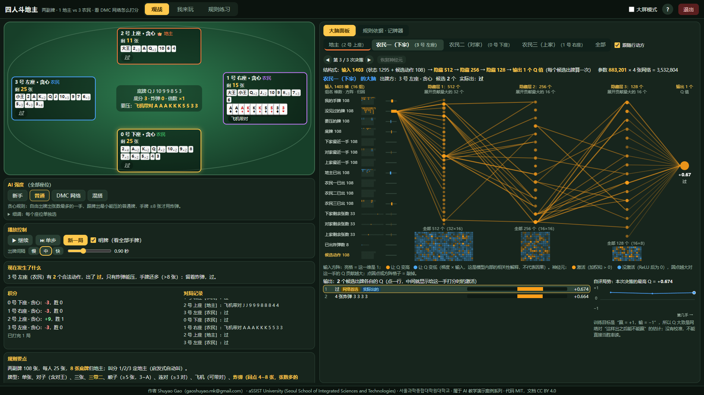
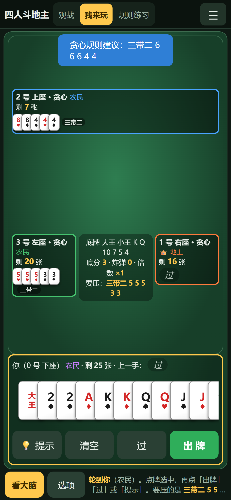

> **AI 教学演示案例 / AI Teaching Demos** 系列

# 四人斗地主（four-player-doudizhu-rl）

**Shuyao Gao**（gaoshuyao.mk@gmail.com）· aSSIST University (Seoul School of Integrated Sciences and Technologies) · 서울과학종합대학원대학교
代码 MIT · 文档与教学素材 CC BY 4.0

**两副牌的四人斗地主（1 地主 vs 3 农民）：完整规则引擎在浏览器里运行，右边“大脑面板”实时画出一张 DMC 强化学习网络给每个合法出牌打的分。** 打开网页就能看 AI 对打、自己坐下打一局、或者照着任务清单练习；手机竖屏也能玩。
同一系列的中国牌类游戏：[掼蛋](https://github.com/ShuyaoGao/guandan-card-engine)、[升级（打百分）](https://github.com/ShuyaoGao/shengji-card-engine)、[保皇](https://github.com/ShuyaoGao/baohuang-card-engine)、[够级](https://github.com/ShuyaoGao/gouji-card-engine)；三人斗地主见 [doudizhu-dmc-lab](https://github.com/ShuyaoGao/doudizhu-dmc-lab)。

*Two-deck four-player DouDizhu with a live DMC "brain panel" in the browser (an honest example of an under-trained network). See the English summary at the end.*





## 怎么打开（都不需要安装）

- **手机**：点在线链接 <https://shuyaogao.github.io/four-player-doudizhu-rl/>（竖屏打开，往下滑看大脑面板；点「我来玩」自己打）。
- **电脑**：点同一个在线链接；或者在 [Releases](https://github.com/ShuyaoGao/four-player-doudizhu-rl/releases) 下载 `four-player-doudizhu-rl-v1.0.zip`，解压后双击 `index.html`；或者点 **Code → Download ZIP**，解压后双击 `play/index.html`。

页面是纯静态网页：不需要 Python，不需要联网，不会在后台留下任何进程。Windows 上的 Edge 和手机尺寸（触屏模拟）都测过；Safari 需要在真实 Mac 上确认（见常见问题）。

## 规则（本项目实现的标准核心规则）

民间牌类变体很多，这里实现的是主流核心规则，取舍都写在下面；改规则只需改 `games/ddz4.py`（和对应的 `play/js/ddz4.js`）一处。

- 两副牌 108 张，每人 25 张，8 张底牌归地主；叫分 1/2/3 定地主（启发式自动叫，全不叫重发）。
- 牌型：单张、对子（含对王）、三张、三带二、顺子（≥5 张，3~A）、连对（≥3 对）、飞机（≥2 组，可不带或每组带一对）、炸弹（同点 4~8 张，**张数多的大**，张数相同比点数）、天王炸（4 个王，最大）。
- 没有三带一、四带二（4 张同点就是炸弹，不可拆带）。
- 任意一家出完即结束：地主出完地主胜，否则农民胜。计分：底分 × 2^炸弹数 × 春天 ×2；地主输赢是每个农民的三倍。

## 怎么用

页面顶部切换三种模式：

| 模式 | 做什么 |
|---|---|
| **观战**（默认） | 所有座位都是 AI，自动对打；可以暂停、单步、调速度、明牌。 |
| **我来玩** | 你坐 0 号位，和 AI 一起打。 |
| **规则练习** | 带任务清单的「我来玩」（对手默认“新手”），做完一项自动打勾；附牌型图鉴。 |

**电脑（键盘鼠标）**：点牌选中（再点取消），<kbd>回车</kbd> 出牌，<kbd>空格</kbd> 过，<kbd>T</kbd> 提示（按贪心规则），<kbd>Esc</kbd> 清空，双击一张牌选中同点数的全部。<kbd>P</kbd> 暂停 / 继续，<kbd>N</kbd> 单步，<kbd>H</kbd> 或右上角 **?** 打开操作说明。右上角「大屏模式」把左右比例从约 45:55 调到 35:65，方便投影。鼠标停在按钮上会有带动画的小提示。

**手机（触屏，竖屏）**：头部压成一行，右上角 ☰ 里有 AI 强度、明牌、新一局、操作说明和退出。观战时牌桌在上（上面一排是其他玩家，左右两侧各一家），大脑面板紧跟在牌桌下面（紧凑画法），往下滑看。点「我来玩」后一屏显示、不用滚动：上方是牌桌，下方是你的手牌——**点牌选中**（再点取消），牌多时**左右滑动**，然后点 **出牌**、**过** 或 **提示**（按钮都够大）。「看大脑」全屏打开右栏面板，「返回」关闭。横屏时会提示竖屏体验更好。

- **右栏**：「大脑面板」（地主 / 农民一 / 农民二 / 农民三 / 全部）：每一手出牌时，那一家身份的 DMC 网络给全部合法出牌打的分、输入方阵、三层隐藏层的真实激活；点神经元可以“敲掉”。「规则依据 · 记牌器」：贪心规则这一步命中了哪一条、在哪些候选里挑、挑了哪一手，下面是记牌器。
- **AI 强度**有几个预设（新手 = 随机、普通 = 贪心规则……），“细调”里可以逐个座位单独选。
- **公平性**：「我来玩」时对手每一步的决策过程在本局结束前锁住（候选动作会暴露它的手牌），打完自动解锁，或打开「明牌（作弊）」。💡 提示用的贪心规则只看你自己的手牌和桌面上的牌。

## 课堂上怎么用（推荐顺序）

1. **观战（3 分钟）**：默认三家贪心规则对打，先认识两副牌的四人斗地主：底牌、叫分、炸弹张数。
2. **暂停 + 单步**：看右栏「规则依据」，贪心规则这一步是“自由出牌出张数最多的”还是“跟牌出最小能压的”。
3. **切到大脑面板**：DMC 网络给不同出牌的分数几乎一样（见下面的成绩）。讨论：网络“学会”了什么？为什么一个训练过的网络会比随机出牌还差？（奖励稀疏、四人博弈、训练不充分……）
4. **我来玩 / 规则练习**：自己坐下打，用 💡 提示对比自己和贪心规则。

## 它是怎么做的

- **规则引擎**：Python 版在 `core/`（多副牌、花色、甩牌类的轮转 / 过牌 / 接风骨架）和 `games/ddz4.py`；浏览器版 `play/js/core.js`、`play/js/ddz4.js` 逐行移植。
- **一致性**：`tests/js/test_engine.js` 用 Python 导出的标准答案（`tests/fixtures/ddz4.json`）逐步核对：同一种子发出的牌、每一步的**合法动作列表（含顺序）**、贪心智能体每一步的选择、终局名次与回报都必须相同。四人斗地主另有 `tests/js/test_parity.js`：浏览器端的状态编码与网络前向与 PyTorch 逐项比对。
- **随机数**：浏览器里用与 Python `random.Random` 完全相同的随机数序列（MT19937，`play/js/pyrandom.js`），所以同一个种子在两边发出同一副牌。
- **AI**：`agents.py` 的随机和贪心规则（自由出牌出张数最多的一手、跟牌出最小能压的普通牌、手牌 ≤8 张才用炸弹）；四人斗地主另有 DMC 网络（见下）。
- **浏览器验收**：`tests/test_browser.py`（1920×1080、1366×768 跑一遍观战单步、右栏面板、我来玩一整局、练习、说明、退出）和 `tests/test_mobile.py`（390×844、414×896、360×780、768×1024 四个触屏尺寸加横屏：没有横向溢出、我来玩整页不滚动、模拟触摸点牌出牌、右栏面板打开 / 返回、没有 JS 报错）。

### DMC 网络（大脑面板里的那一张）

- **结构**：四个身份（地主 / 农民一 / 农民二 / 农民三）各一张 Q 网络，每张 1,403 → 512 → 256 → 128 → 1（ReLU），883,201 个参数，四张共 3,532,804 个（`checkpoints/dmc_ddz4.pt`）。
- **输入 1,403 维** = 状态 1,295 维 + 候选动作 108 维。每一组牌都编码成 108 维（13 个点数 × 8 个张数档位 + 大小王各 2 档）：我的手牌、没见过的牌、要压的牌、底牌、下家 / 对家 / 上家最近一手、四家已出的牌，再加三家剩余张数（各 33 维）和已出炸弹数（8 维）。大脑面板上每一维的名字由 `tests/test_feature_names.py` 锁定，与 `games/ddz4.py` 的编码逐维对应。
- **训练**：深度蒙特卡洛（DMC，与姊妹项目 doudizhu-dmc-lab 同一套做法）：自博弈打完整局，终局团队胜负 ±1 作为每一步的回归目标。**这个模型是事先训练好的，训练步数和用时没有记录。**
- **它其实没学会**：DMC 对随机的胜率只有 41.5%，对贪心 15.0%，比随机出牌还弱。贪心对打 20 局、726 个决策点里，网络给同一局面不同出牌的分数“最高 - 最低”中位数只有 0.0066（最大 0.041；训练目标是赢 +1、输 −1），首选与贪心规则相同的只有 30.0%。所以页面默认的 AI 是贪心规则，DMC 网络只作为“看大脑”的对象：它是一个**训练不充分的网络长什么样**的真实例子。
- **浏览器里的网络**：权重转成 float16（`play/js/model_dmc4.js`，约 9.4 MB），用纯 JavaScript 前向；`tests/js/test_parity.js` 与 PyTorch 逐个比 Q 值（同一份 float16 权重误差 < 1e-5，与原始 float32 权重误差 < 5e-4，最优动作一致）。

### 成绩（`results/result.json`，固定种子，可复现）

每组 200 局、换边各打一半，种子 2026（`tools/run_eval.py` 调用 `evaluate.py` 的对战函数）：

| 对局 | 局数 | 该智能体所在队伍胜率 | Wilson 95% 区间 |
|---|---:|---:|---|
| 贪心 vs 随机 | 200 | 86.5% | 81.1% – 90.5% |
| DMC vs 随机 | 200 | 41.5% | 34.9% – 48.4% |
| DMC vs 贪心 | 200 | 15.0% | 10.7% – 20.6% |

每组换边各打一半；胜率 = 该智能体所在队伍赢的局数 / 总局数。各游戏强弱队结构不同，50% 即为同强度。

## 想自己跑或修改

需要 Python 3.10+：

```bash
pip install -r requirements.txt     # numpy、torch（CPU 版即可）、pytest
python evaluate.py --games 200      # 对战评估（换边各半）
python -m tools.run_eval            # 固定种子重跑评估 → results/result.json
python -m tools.export_fixtures     # 改了规则后，重新生成浏览器版的测试夹具
python -m tools.build --release     # 重新生成 play/js/credits.js，打包 release/*.zip
python -m tools.screenshots         # 重新截 README 的图（电脑 + 手机；需要 pip install playwright）
python -m pytest                    # 全部测试（JS 测试需要 Node.js；浏览器测试需要本机 Edge 和 playwright）
```

想重新训练 DMC 网络（CPU 即可）：

```bash
python train.py --game ddz4 --max-minutes 30   # 覆盖 checkpoints/dmc_ddz4.pt
python -m tools.export_model                   # 重新导出 play/js/model_dmc4.js
python -m tools.run_eval
```

## 目录结构

```
index.html           根目录跳转页（GitHub Pages 和 Release zip 的入口，自动跳到 play/）
play/                双击即玩的静态网页（index.html、css/、js/）
  css/base.css、table.css   电脑端样式    css/mobile.css   手机竖屏样式（牌类通用）
  js/ddz4.js          规则引擎（移植自 games/ddz4.py）
  js/core.js          多副牌、花色、甩牌骨架、随机 / 贪心智能体（移植自 core/、agents.py）
  js/table.js         页面逻辑（模式、出牌流程、规则依据、练习、说明、退出）
  js/mobile.js        手机竖屏工具：设备判断、☰ 菜单、全屏面板、横屏提示、防误触（牌类通用）
  js/ddz4_ui.js       这个游戏的界面配置（牌型名称、任务清单、图鉴……）
  js/nn.js            浏览器端网络前向（float16 权重）
  js/brain.js         大脑面板（4 个智能体）
  js/model_dmc4.js    导出的权重（tools/export_model.py 生成）
core/                多副牌、花色、甩牌类骨架（轮转 / 过牌 / 接风）
games/ddz4.py          规则引擎
agents.py            随机 / 贪心智能体
evaluate.py          对战评估
rl_dmc.py            通用 Deep Monte Carlo（每个身份一张 Q 网络）
train.py             DMC 自博弈训练
checkpoints/         dmc_ddz4.pt
results/             result.json（评估结果）
tools/               构建、评估、导出夹具、浏览器自检（edge.py）、手机尺寸验收（mobile_check.py）、截图、署名填充
tests/               Python 测试（含 test_browser.py、test_mobile.py）、tests/js（Node 差分测试）、tests/fixtures（Python 导出的标准答案）
docs/img/            截图（电脑 + 手机）
```

## 常见问题

- **关掉页面后还在后台跑吗？** 不会。这是纯静态网页，关掉标签页就全部结束，不留后台进程。「退出」（电脑右上角；手机在 ☰ 里）会先停掉所有计时器，再尝试关闭标签页；浏览器不允许关闭时，会显示“已停止运行”。
- **手机上怎么玩？** 竖屏打开在线链接。观战时往下滑看大脑面板；点「我来玩」后点牌选中、左右滑动看更多牌，再点「出牌」「过」「提示」；「看大脑」全屏打开右栏，「返回」关闭。
- **双击 index.html 却用记事本打开了？** 右键 →「打开方式」→ 选浏览器。
- **Mac 上能用吗？** 页面只用标准 HTML / JavaScript，Safari 应该可以打开，但作者还没在真实 Mac 上测过，遇到问题欢迎反馈。Firefox 也没有测过。
- **规则和我家乡的玩法不一样？** 很正常。这里实现的是主流核心规则，取舍都写在上面的“规则”一节里。

## 许可证与引用

代码 MIT（[LICENSE](LICENSE)），文档 CC BY 4.0（[LICENSE-docs](LICENSE-docs)），使用请注明出处。
引用信息见 [CITATION.cff](CITATION.cff)（GitHub 右侧 “Cite this repository”）。第三方组件与来源见 [THIRD_PARTY.md](THIRD_PARTY.md)。

## AI 辅助开发声明

代码由 Claude Code 辅助编写，经作者审阅。

## English summary

**four-player-doudizhu-rl** is a browser-only teaching demo of two-deck four-player DouDizhu (one landlord vs three peasants). The full rule engine runs in JavaScript and is checked move-by-move against the Python engine. A live "brain panel" shows how a Deep Monte Carlo (DMC) Q-network scores every legal move, with real activations computed from float16 weights; a rule panel explains the greedy baseline. Honest result: this DMC model is weaker than random play, so it is presented as an example of an under-trained network. The page runs fully offline (double-click `index.html`) and works on phones in portrait mode (tap cards, scroll the hand, big play / pass / hint buttons, full-screen side panel). Code: MIT; docs: CC BY 4.0. Author: Shuyao Gao (gaoshuyao.mk@gmail.com), aSSIST University (Seoul School of Integrated Sciences and Technologies).
